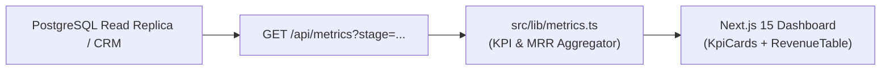

# Next.js B2B Operations Portal & Real-Time BI Dashboard Starter

[](https://github.com/agenciaiaonline-wq/nextjs-b2b-bi-dashboard-starter/actions/workflows/ci.yml)
[](package.json)
[](tsconfig.json)
[](LICENSE)

> **Executive B2B portal, pipeline & MRR telemetry dashboard, and API layer engineered with Next.js 15 App Router, TypeScript, Tailwind CSS, TanStack Table, and Recharts.**

Modeled on top-starred open-source Next.js admin & BI starters (`next-shadcn-dashboard-starter`, `next-shadcn-admin-dashboard`), this blueprint delivers strict TypeScript metrics aggregation, filtered JSON telemetry endpoints, and production security headers.

---

## Architecture Flow



---

## Project Structure

```text
nextjs-b2b-bi-dashboard-starter/
├── .github/workflows/ci.yml
├── src/
│   ├── app/
│   │   ├── layout.tsx
│   │   ├── page.tsx                     # Executive KPI + Revenue Operations UI
│   │   └── api/metrics/route.ts         # Stage-filtered BI telemetry endpoint
│   ├── components/
│   │   ├── KpiCards.tsx                 # Pipeline, Won Revenue, MRR & SLA cards
│   │   └── RevenueTable.tsx             # Account & recurring retainer table
│   └── lib/metrics.ts                   # Pure TypeScript KPI computation module
├── tests/verify_dashboard.mjs           # Node test suite validating KPI math & files
├── next.config.ts
├── package.json
├── SECURITY.md
└── .env.example
```

---

## Quick Start

```bash
cp .env.example .env.local
npm install
npm test
npm run dev
```

---

## Book a Custom B2B Portal & BI Build (`USD 4,000 - 12,000`)
- **LinkedIn Studio:** [Golden Nodalix Studio](https://www.linkedin.com/in/agency-golden-nodalix-880598438/)
- **Profile Hub:** [agenciaiaonline-wq](https://github.com/agenciaiaonline-wq)
- **Email:** `studio@example.com`
